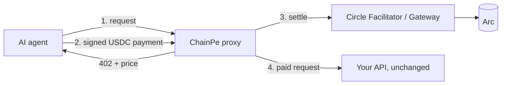

# ChainPe

**Turn any API into a paid service for AI agents on Arc, in one command.**

AI agents want to pay for APIs, but most APIs only take API keys and monthly plans.
ChainPe puts a price on any HTTP API. Agents pay per call in USDC on Arc, and Circle settles each payment.
ChainPe is for **developers** who already run an API, an MCP server or an AI agent. It is not a checkout for shops.

[](LICENSE)
[](https://explorer.testnet.arc.io/address/0xD315322c9D83A6f50A04236A2a242e0259bfB580)

## Live links

| What | Link |
|---|---|
| Demo API (a weather API behind ChainPe) | https://chainpe-arc-demo-production.up.railway.app |
| Docs | https://chainpe.vercel.app/docs |
| Provider dashboard | https://chainpe.vercel.app/dashboard |
| Arc Studio workspace (contracts + dashboard) | https://studio.arc.io/app/6872b96e-b3c0-4cdb-abe3-5f17865cdf5a |
| `ChainPeAccounts` contract (verified source) | [0xD315…B580 on the Arc explorer](https://explorer.testnet.arc.io/address/0xD315322c9D83A6f50A04236A2a242e0259bfB580) |
| Proof of live payments | [docs/arc/PROOF.md](docs/arc/PROOF.md) |

Everything runs on **Arc testnet** today.

## How it works

1. **An agent calls your API.** ChainPe answers with `402 Payment Required` and a price in USDC.
   (This is **x402**: an open standard that uses the HTTP status 402 to ask for a payment.)
2. **The agent pays.** It signs a USDC payment from its wallet. It never needs an API key or an account.
3. **Circle settles the payment on Arc.** Arc is Circle's blockchain, where fees are paid in USDC.
4. **Your API answers.** ChainPe calls your API only after the payment is settled.



**Two ways to pay.** A normal x402 payment moves USDC on Arc for each call.
**Gateway** (Circle's nanopayment service) lets an agent pay from a prepaid balance, with no gas, for prices below one cent.
Circle settles Gateway payments in batches. ChainPe offers both, and the agent picks one.

## Try it in 5 minutes

```sh
npm install -g @chainpearc/cli
```

The command is `chainpe`. It needs Node.js 22.18 or newer.

**Sell your API (provider):**

```sh
chainpe init                          # your API URL, price and payout wallet
chainpe start --network arc-testnet   # the paying proxy, in front of your API
chainpe identity                      # an ERC-8004 identity for your service
chainpe register                      # your provider account on Arc
chainpe login                         # connects this machine to the dashboard
chainpe doctor                        # checks you are ready for agents and Circle's marketplace
```

Going public and keeping your key safe: [packages/chainpe/README.md](packages/chainpe/README.md#go-public).

**ERC-8004** is a standard on-chain registry for agent identities and ratings.

**Pay an API (buyer):** get free test USDC at https://faucet.circle.com (pick Arc Testnet), then:

```sh
export CHAINPE_PRIVATE_KEY=<a test wallet key>
chainpe fetch "https://chainpe-arc-demo-production.up.railway.app/forecast?city=Mumbai" \
  --network arc-testnet --rail exact --max 0.02
```

A step-by-step guide for a first payment: [docs/arc/TRY-IT.md](docs/arc/TRY-IT.md).

## Before and during the hackathon

### Before (June 2026, on Avalanche)

ChainPe first ran on Avalanche C-Chain mainnet. It had the x402 proxy CLI, an SDK, AI framework tools,
an MCP wallet for Claude, on-chain reputation, and a hosted facilitator and indexer.
That version is kept at the tag [`avalanche-june-2026`](https://github.com/SamyaDeb/ChainPe/tree/avalanche-june-2026),
and its README is in [docs/avalanche/README.md](docs/avalanche/README.md).

Proof from June 17, 2026: a real 0.01 USDC payment ([tx](https://snowtrace.io/tx/0x953923f2b653953b4f8b0d5ea1925361a0c967a8cb9b2a542814b7d564d92006))
and a service registered on-chain ([tx](https://snowtrace.io/tx/0x1ffb99ecfa2c85f59845ae1f3a3de1d67a8e273458e3bbe733fcfd251aca73f0)).

### During ETHGlobal Mumbai (November 2026, on Arc)

| What we built | Why it matters | Proof |
|---|---|---|
| Moved to x402 v2 and Arc | The old x402 version did not support Arc at all | [spec 01](docs/arc/specs/01-x402-v2-and-arc-networks.md) |
| Settlement through Circle's Facilitator Service | Circle pays the gas, and your API runs only after the payment settles | [paid call](https://explorer.testnet.arc.io/tx/0x11027eae23b4efd8419e7fdfae073622d6096efb0767882d30a71080df83c6c9) |
| Gateway nanopayments | Agents can pay $0.001 per call with no gas | [design and live results](docs/arc/specs/03a-gateway-design.md) |
| `ChainPeAccounts` contract, built and deployed with Arc Studio | Provider accounts and the Pro plan, on-chain | [Studio log](docs/arc/STUDIO-LOG.md) |
| Security review of the contract | One Medium issue found and fixed before launch, 101 tests | [review](docs/arc/reviews/chainpe-accounts-review.md) |
| ERC-8004 identity on Arc's official registry | The demo service is agent 897796 | [mint tx](https://explorer.testnet.arc.io/tx/0xf7003065334a3e4fcd2f24c88b2b36db24b8cd2fdcddfb23095a727eee391a52) |
| `chainpe doctor` | Checks a service is ready for agents and for Circle's marketplace | [listing pack](docs/arc/LISTING.md) |
| `chainpe-cloud` | Revenue is checked against Arc and Circle's records, not taken on trust | [design](docs/arc/specs/08a-cloud-design.md) |
| Provider dashboard, built with Arc Studio | Each developer sees only their own revenue, buyers and ratings | [review](docs/arc/reviews/dashboard-review.md) |

Commits during the hackathon: **79** on the `arc` branch, as of Nov 6, 2026 at 11:00 IST
(`git log --oneline avalanche-june-2026..arc`).

## Business model

- The CLI, proxy and SDK are free and open source.
- Every registered developer gets a dashboard. **Free** covers one service and the last 7 days.
- **Pro** costs 19 USDC per 30 days (1 USDC on testnet), paid on Arc. It adds full history, CSV export and more detail.
- **Opt-in usage fee:** 1% of verified revenue, or 0.5% on Pro. The fee contract (`0x09c85EEdeF018274861aae0964f9681C11f91Af4`) is live on Arc testnet, and only a provider who approves an allowance in Billing is charged. Buyers still pay the seller's wallet directly, because Circle only settles to a wallet the seller signs for. The fee will be collected afterwards, in batches, from USDC the seller approves and can revoke. Details: [spec 12](docs/arc/specs/12-usage-fees.md).

More detail: [docs/arc/BUSINESS-MODEL.md](docs/arc/BUSINESS-MODEL.md).

## Built with Circle and Arc

| Product | How ChainPe uses it |
|---|---|
| Arc | The chain for payments, provider accounts and identities. Gas is paid in USDC |
| Arc Studio | Built, tested and deployed the `ChainPeAccounts` contract and the dashboard |
| Circle Facilitator Service | Settles normal x402 payments on Arc, before the provider's API runs |
| Circle Gateway | Batched nanopayments with no gas, plus seller withdrawals |
| Circle Agent Marketplace and Discovery API | Where agents find services. `chainpe doctor` prepares the listing (not listed yet) |
| ERC-8004 registries on Arc | Service identity and ratings |
| USDC | The only currency used for payments and for the Pro plan |

## Security and honest limits

- **Paid before served.** Your API is never called for a payment that is pending or failed.
- **Gateway is served on acceptance.** Circle locks the buyer's funds and the batch lands a few minutes later.
  If a batch ever failed, the seller would have served for free. The cloud service marks it as failed.
- **No refunds yet.** If your API fails after a payment, the buyer is still charged. The proxy counts these cases.
- **Anyone can rate an agent** on ERC-8004. The dashboard shows ratings from real payers first.
- **Testnet only.** Nothing has run on Arc mainnet yet, so `chainpe start` refuses it without `--allow-mainnet`.
- **Not in Circle's marketplace yet.** The listing is prepared. Once submitted, Circle reviews it by hand.

Reviews: [contract](docs/arc/reviews/chainpe-accounts-review.md) and [dashboard](docs/arc/reviews/dashboard-review.md).
More limits: [proxy spec](docs/arc/specs/04-cli-proxy-arc.md) and [Gateway design](docs/arc/specs/03a-gateway-design.md).

## Repo map

| Folder | What is inside |
|---|---|
| `packages/chainpe` | The CLI and the paying proxy |
| `contracts-arc` | `ChainPeAccounts` contract and tests (Foundry) |
| `services/chainpe-cloud` | The API behind the dashboard |
| `apps/arc-dashboard` | The provider dashboard |
| `examples/arc-demo` | The live demo seller |
| `docs/arc` | Plan, specs, reviews and proof for the Arc version |
| `docs/avalanche` | The June 2026 Avalanche README |

## Docs

Start at [docs/arc/README.md](docs/arc/README.md). It links the plan, the architecture and every spec.

## License

[MIT](LICENSE)
