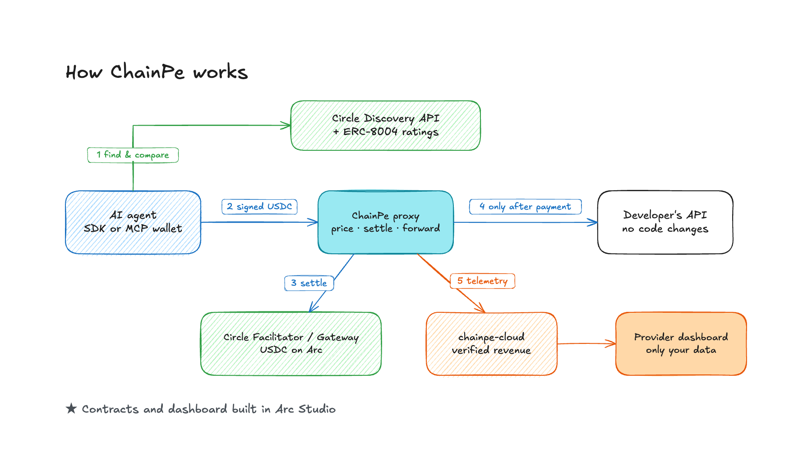

<p align="center">
  <picture>
    <source media="(prefers-color-scheme: dark)" srcset="apps/dashboard/public/logo-dark.png">
    
  </picture>
</p>

<h1 align="center">ChainPe</h1>

**The payment and trust layer for software that buys from software.**

Put a USDC price on any existing API, MCP server or AI agent with one command and no code changes. Agents find it, check its on-chain reputation, pay per call on Arc, and get the answer. Developers see revenue verified against the chain.

[](https://explorer.testnet.arc.io/address/0xD315322c9D83A6f50A04236A2a242e0259bfB580)
[](https://www.npmjs.com/package/@chainpearc/cli)
[](#tests-and-reviews)
[](LICENSE)

| | |
|---|---|
| **Live product** | https://chainpe.vercel.app |
| **Provider dashboard** | https://chainpe.vercel.app/dashboard |
| **Live paid API** | [Routes and prices](https://chainpe-arc-demo-production.up.railway.app/openapi.json), and it [answers 402 until paid](https://chainpe-arc-demo-production.up.railway.app/forecast?city=Mumbai) |
| **Arc Studio workspace** | https://studio.arc.io/app/6872b96e-b3c0-4cdb-abe3-5f17865cdf5a (requires a Circle login) |
| **Docs** | https://chainpe.vercel.app/docs |
| **Every live transaction** | [docs/arc/PROOF.md](docs/arc/PROOF.md) |
| **Demo video** | On the project's ETHGlobal submission page |

## For judges: the 60-second version

Built for **ETHGlobal Mumbai, Arc Studio Continuity Track**. The track asks for "nanopayment infrastructure shipped into an existing AI agent or API monetization tool". That is what this is.

| Requirement | Evidence |
|---|---|
| Existing project brought to Arc | Live on Avalanche in June 2026, at tag [`avalanche-june-2026`](https://github.com/SamyaDeb/ChainPe/tree/avalanche-june-2026). See [before and during](#before-and-during-the-hackathon) |
| Built in Arc Studio | Contracts and dashboard: [workspace](https://studio.arc.io/app/6872b96e-b3c0-4cdb-abe3-5f17865cdf5a), [every run with trace IDs](docs/arc/STUDIO-LOG.md), [the prompts used](docs/arc/prompts) |
| Working frontend and backend | [Dashboard](https://chainpe.vercel.app/dashboard), [API health](https://chainpe-cloud-production.up.railway.app/health), [paid API](https://chainpe-arc-demo-production.up.railway.app/health) |
| Architecture diagram | [Below](#architecture), plus the [full diagram](docs/arc/diagrams/chainpe-architecture.png) ([editable](docs/arc/diagrams/chainpe-architecture.excalidraw)) |
| Circle's developer tools | Facilitator, Gateway, Discovery API and App Kit. [How each is used](#built-on-arc-and-circle) |
| Real transactions | [Verified on-chain](#proof-it-runs) |

**See it yourself in 10 seconds.** This is the live API refusing to answer until it is paid:

```sh
curl -i "https://chainpe-arc-demo-production.up.railway.app/forecast?city=Mumbai"
# HTTP/2 402, with a PAYMENT-REQUIRED header offering two ways to pay in USDC on Arc
```

## The problem

AI agents can read, write code and browse the web, but they cannot pay. That creates three problems:

1. **APIs are sold to humans.** Sign-up forms, API keys and monthly plans all assume a person is there. An agent that needs one call must rely on a key someone hard-coded for it.
2. **Small calls have nowhere to go.** A subscription is far too big for one $0.001 lookup, and a normal on-chain payment can cost more in gas than the call is worth. So most API calls are never sold to agents at all.
3. **Agents can't tell who to trust.** Anyone can publish an endpoint that claims the lowest price. Once an agent can spend money, a cheap, dishonest service is a real risk.

Paying is only half of this. An agent needs to know who to pay, and a developer needs to trust the revenue they see.

## The solution

ChainPe puts a paying proxy in front of what a developer already runs:

- **For developers:** one command prices any API, in any language, with no code changes and no custody. The money goes straight to their wallet.
- **For agents:** discover services, compare reputation, pay per call in USDC, with no account or API key. Use the SDK, or give Claude a wallet over MCP.
- **For both:** ratings live on-chain in ERC-8004, and revenue is checked against Arc and Circle's records.

### What makes it different

| | |
|---|---|
| **Works with what exists** | It wraps a running API instead of asking you to rebuild it. If it speaks HTTP, you can sell it |
| **Pay first, serve second** | Your backend is never called for a pending or failed payment |
| **Both payment rails, one proxy** | A direct USDC payment per call, or gas-free Circle Gateway nanopayments from $0.001. The agent picks |
| **Reputation that can be measured** | Our demo scores swap agents by the EURC that actually arrives, not by what they claim |
| **Revenue you don't have to take on trust** | Dashboard revenue is matched to Arc's transfer logs and Circle's records |
| **Spending limits for agents** | Per-call and per-day caps, checked before anything is signed |

## Architecture



1. **Find and compare.** The agent searches Circle's Discovery API and ChainPe's on-chain listings, then ranks results by ERC-8004 reputation.
2. **Signed USDC.** It calls the API and gets `402 Payment Required` with the price. It signs a USDC payment and retries. It needs no gas, API key or account.
3. **Settle.** The proxy sends the payment to Circle's Facilitator (direct) or Gateway (nanopayment). USDC moves from the buyer straight to the developer's wallet. **ChainPe never holds the money.**
4. **Only after payment.** The request reaches the developer's API, and the result goes back with a payment receipt.
5. **Telemetry.** The proxy reports the payment to `chainpe-cloud`, which verifies it against Arc's transfer logs and Circle's Gateway records. Each developer signs in with their wallet and sees only their own data.

The agent can then post a 0–100 rating to ERC-8004, which ranks the next agent's search.

**Going deeper:** [full diagram with every flow](docs/arc/diagrams/chainpe-architecture.png) and [architecture doc with sequence diagrams](docs/arc/ARCHITECTURE.md).

## Proof it runs

All of these are real transactions on Arc Testnet, and they all succeeded.

| What happened | Transaction |
|---|---|
| An API call paid directly, through Circle's Facilitator | [0x9040…224a](https://explorer.testnet.arc.io/tx/0x90404e6ba982d895cc3655d6d44561e36fc34b40b8e59d5d69b7d6774244224a) |
| A Gateway batch settling $0.001 nanopayments | [0x6f78…44de](https://explorer.testnet.arc.io/tx/0x6f784cdbda4bb0defc4ca0561317d85cf1bd388b89d33f7e6bc9ed79a8d844de) |
| Claude Desktop paying the best-rated agent for a quote, through the MCP wallet | [0xd375…3535](https://explorer.testnet.arc.io/tx/0xd375f8377527f3e914458c8470f78dc69e16e57d149c1b268e7aa3ea23503535) |
| An autonomous script hiring that agent for a swap: 0.660455 EURC measured on-chain | [0xe463…2c3c](https://explorer.testnet.arc.io/tx/0xe463fa9f09a558c464ca29e5701cd34ffa6ead6b5e6f24eccf9f6d62ca692c3c) |
| That script posting its measured score to ERC-8004 | [0xe316…1c60](https://explorer.testnet.arc.io/tx/0xe3169f03d477eb6dcb2034f89fd84cb1fdf5696740d8af5506a52c95854e1c60) |
| A provider buying the Pro plan in USDC | [0xa8b1…cf9a](https://explorer.testnet.arc.io/tx/0xa8b116b3af98f7f6ef8c3b36478493a6d415f2bc256e33ccfcd7a53b3c97cf9a) |
| The opt-in 1% usage fee collected on $0.15 of verified revenue | [0x88b1…bb5](https://explorer.testnet.arc.io/tx/0x88b1f5fa54f97ab0cf8324eb9db793b71ab23e9a91bc06a83977188378aafbb5) |

Full log with timestamps: [docs/arc/PROOF.md](docs/arc/PROOF.md).

### The demo: reputation catching a bad actor

[`examples/arc-swap-agents`](examples/arc-swap-agents) runs three real swap agents, each paid over x402 and swapping through Circle App Kit:

| Agent | Fee | Behaviour | Measured score |
|---|---|---|---|
| Bolt Swap | 0.03 USDC | Tight slippage, one attempt, refunds on failure | 100 |
| Harbor Swap | 0.05 USDC | Wide slippage, retries, refunds on failure | 100 |
| Drift Swap | 0.01 USDC | **Cheapest, but we built it to keep 5% of each swap** | 58 |

A buyer that only looks at price picks Drift. An agent that reads reputation rejects it. Scores come from comparing the EURC received on-chain with a quote taken just before the swap ([`scoreFor`](examples/arc-swap-agents/agents.mjs)). We seeded these ratings from our own test wallets, from real paid swaps.

These agents run on demand behind temporary tunnels, so they may be offline when you read this. The weather API above is always on. To run them yourself, see the [example's README](examples/arc-swap-agents/README.md).

## Try it

Needs Node.js 22.18 or newer, and a test wallet with free USDC from https://faucet.circle.com (choose Arc Testnet).

**Sell an API:**

```sh
npm install -g @chainpearc/cli

chainpe init                          # your API URL, price and payout wallet
chainpe start --network arc-testnet   # the paying proxy, in front of your API
chainpe identity                      # an ERC-8004 identity for your service
chainpe register                      # your provider account on Arc
chainpe login                         # connects this machine to the dashboard
chainpe doctor                        # checks you're ready for agents and Circle's marketplace
```

Your API needs a public HTTPS URL for listing. See [going public](packages/chainpe/README.md#go-public).

**Pay for an API, from the terminal:**

```sh
export CHAINPE_PRIVATE_KEY=<a test wallet key>
chainpe fetch "https://chainpe-arc-demo-production.up.railway.app/forecast?city=Mumbai" \
  --network arc-testnet --rail exact --max 0.02
```

**Pay for an API, from your agent's code:**

```js
import { ChainPe } from '@chainpearc/sdk'

const cp = new ChainPe({ privateKey: process.env.AGENT_KEY, network: 'arc-testnet', maxPerCall: '0.10' })

const [best] = await cp.discover({ query: 'weather' })   // ranked by on-chain reputation
const { data, payment } = await cp.pay(`${best.endpoint}/forecast?city=Mumbai`)   // pays the 402
```

**Give Claude a wallet:** install [`@chainpearc/wallet-mcp`](packages/chainpe-wallet/README.md). Claude can then find, pay for and rate services within your limits.

A first-payment walkthrough is in [docs/arc/TRY-IT.md](docs/arc/TRY-IT.md).

## Built on Arc and Circle

We used Circle's services instead of rebuilding them.

| Product | How ChainPe uses it | Code |
|---|---|---|
| **Arc** | The chain for payments, accounts and identities. Gas is paid in USDC | [`chains.ts`](packages/chainpe/src/chains.ts) |
| **Arc Studio** | Built, tested and deployed the contracts, and built the dashboard | [Studio log](docs/arc/STUDIO-LOG.md) |
| **Circle Facilitator** | Settles direct x402 payments before the API runs | [`circleFacilitator.ts`](packages/chainpe/src/proxy/circleFacilitator.ts) |
| **Circle Gateway** | Gas-free nanopayments in batches, and seller withdrawals | [`gateway.ts`](packages/chainpe/src/proxy/gateway.ts) |
| **Circle Discovery API** | How agents find services. `chainpe doctor` prepares the listing | [`discovery.ts`](packages/chainpe-sdk/src/discovery.ts) |
| **Circle App Kit** | Runs the swaps in the demo agents | [`swap-agent.mjs`](examples/arc-swap-agents/swap-agent.mjs) |
| **ERC-8004 on Arc** | Service identity and ratings | [`reputation.ts`](packages/chainpe-sdk/src/reputation.ts) |
| **USDC** | The only currency for payments and plans | |

### Built in Arc Studio

| Run | What Studio built | Result |
|---|---|---|
| 1, 1b | `ChainPeAccounts`: provider accounts, listings and USDC plans | Deployed, source verified |
| 2–7 | The provider dashboard, its review fixes and wallet sign-in | Live at [/dashboard](https://chainpe.vercel.app/dashboard) |
| 8 | `ChainPeFees`: the opt-in usage fee | Deployed, source verified |
| 9, 9b | Diagnosed and fixed a stale-config bug in the preview server | Logged |

Prompts, trace IDs and deployments for every run: [docs/arc/STUDIO-LOG.md](docs/arc/STUDIO-LOG.md).

## Contract addresses

Arc Testnet, chain ID `5042002`.

**Deployed by ChainPe, through Arc Studio:**

| Contract | Purpose | Address |
|---|---|---|
| `ChainPeAccounts` | Provider accounts, service listings, Pro plan | [`0xD315322c9D83A6f50A04236A2a242e0259bfB580`](https://explorer.testnet.arc.io/address/0xD315322c9D83A6f50A04236A2a242e0259bfB580) |
| `ChainPeFees` | Opt-in usage fee, capped at 5% | [`0x09c85EEdeF018274861aae0964f9681C11f91Af4`](https://explorer.testnet.arc.io/address/0x09c85EEdeF018274861aae0964f9681C11f91Af4) |

**Arc and Circle contracts we use:**

| Contract | Address |
|---|---|
| USDC (ERC-20 interface, 6 decimals) | [`0x3600000000000000000000000000000000000000`](https://explorer.testnet.arc.io/address/0x3600000000000000000000000000000000000000) |
| EURC | [`0x89B50855Aa3bE2F677cD6303Cec089B5F319D72a`](https://explorer.testnet.arc.io/address/0x89B50855Aa3bE2F677cD6303Cec089B5F319D72a) |
| ERC-8004 Identity Registry | [`0x8004A818BFB912233c491871b3d84c89A494BD9e`](https://explorer.testnet.arc.io/address/0x8004A818BFB912233c491871b3d84c89A494BD9e) |
| ERC-8004 Reputation Registry | [`0x8004B663056A597Dffe9eCcC1965A193B7388713`](https://explorer.testnet.arc.io/address/0x8004B663056A597Dffe9eCcC1965A193B7388713) |
| Circle Gateway Wallet | [`0x0077777d7EBA4688BDeF3E311b846F25870A19B9`](https://explorer.testnet.arc.io/address/0x0077777d7EBA4688BDeF3E311b846F25870A19B9) |

**ERC-8004 agent IDs:** the weather API is `897796`. The swap agents are Harbor `897798`, Bolt `897799` and Drift `897800`.

## Published packages

| Package | What it does |
|---|---|
| [`@chainpearc/cli`](https://www.npmjs.com/package/@chainpearc/cli) | The `chainpe` command and paying proxy |
| [`@chainpearc/sdk`](https://www.npmjs.com/package/@chainpearc/sdk) | Discover, pay and rate, from your agent's code |
| [`@chainpearc/wallet-mcp`](https://www.npmjs.com/package/@chainpearc/wallet-mcp) | A USDC wallet for Claude, with spending limits |
| [`@chainpearc/ai-tools`](https://www.npmjs.com/package/@chainpearc/ai-tools) | Tools for the Vercel AI SDK and LangChain |
| [`@chainpearc/agent`](https://www.npmjs.com/package/@chainpearc/agent) | A ready-made paying agent |

## Business model

Buyers pay developers directly, so ChainPe never touches the payment. It earns from the developers who get value from it.

| | Free | Pro |
|---|---|---|
| **Price** | 0 | 1 USDC per 30 days on testnet, 19 USDC planned on mainnet, paid on Arc |
| **Dashboard** | One service, last 7 days | Up to 10 services, full history, CSV export |
| **Opt-in usage fee** | 1% of verified revenue | 0.5% of verified revenue |

The CLI, proxy and SDK stay free and open source. The fee is collected afterwards from a USDC allowance the developer approves and can revoke. A developer who opts out gives up verified revenue and the dashboard, not the ability to get paid. More in [docs/arc/BUSINESS-MODEL.md](docs/arc/BUSINESS-MODEL.md).

## Before and during the hackathon

**Before, June 2026, on Avalanche.** ChainPe ran on Avalanche C-Chain mainnet with an x402 proxy CLI, an SDK, AI framework tools, an MCP wallet for Claude, on-chain reputation, and a hosted facilitator and indexer. It's kept at tag [`avalanche-june-2026`](https://github.com/SamyaDeb/ChainPe/tree/avalanche-june-2026), with its old README in [docs/avalanche/README.md](docs/avalanche/README.md). Proof: a real 0.01 USDC payment ([tx](https://snowtrace.io/tx/0x953923f2b653953b4f8b0d5ea1925361a0c967a8cb9b2a542814b7d564d92006)).

**During, ETHGlobal Mumbai, November 2026, on Arc.** More than 150 commits after that tag (`git log --oneline avalanche-june-2026..main`):

| New work | Why it matters | Detail |
|---|---|---|
| Moved to x402 v2 and Arc | The old x402 version doesn't support Arc | [spec 01](docs/arc/specs/01-x402-v2-and-arc-networks.md) |
| Settlement through Circle's Facilitator | Replaces our own facilitator. The API runs only after settlement | [spec 02](docs/arc/specs/02-circle-facilitator-adapter.md) |
| Gateway nanopayments | Calls from $0.001 with no gas | [design](docs/arc/specs/03a-gateway-design.md) |
| `ChainPeAccounts` and `ChainPeFees` | Accounts, plans and fees on-chain, built in Arc Studio | [log](docs/arc/STUDIO-LOG.md) |
| `chainpe-cloud` and the provider dashboard | Revenue verified against Arc and Circle | [design](docs/arc/specs/08a-cloud-design.md) |
| ERC-8004 on Arc's official registries | Identity and ratings on Arc | [spec 10](docs/arc/specs/10-erc8004-identity.md) |
| `chainpe doctor` | Checks readiness for agents and Circle's marketplace | [listing pack](docs/arc/LISTING.md) |
| Swap agents and `hire-best` | Reputation measured from real swaps | [example](examples/arc-swap-agents) |

## Tests and reviews

- **413 Node tests pass** across the CLI, SDK, AI tools, wallet and agent.
- **136 Foundry tests pass** on the contracts, including fuzz and invariant tests.
- **Written reviews:** [contract](docs/arc/reviews/chainpe-accounts-review.md) and [dashboard](docs/arc/reviews/dashboard-review.md). These are internal reviews, not an independent audit.

```sh
npm install && npm run build && npm test
cd contracts-arc && forge test
```

## Honest limits

We'd rather you read these here than find them later.

- **Testnet only.** Nothing has run on Arc mainnet, and `chainpe start` refuses it without `--allow-mainnet`. The contracts haven't had an independent audit.
- **Gateway is served on acceptance.** Circle locks the buyer's funds and the batch lands minutes later. If a batch ever failed, the seller would have served for free, and the dashboard marks it as failed. That failure path is tested against a stubbed response, not seen live.
- **No automatic refunds in the proxy.** If an API fails after payment, the buyer is still charged, and the proxy counts these cases.
- **Anyone can rate an agent.** The dashboard shows ratings from real payers first. The demo's ratings come from our own test wallets.
- **Claude Desktop won't run swaps.** It refused to execute one, even on testnet, so it compares agents and pays for a quote, and the autonomous script runs the swap.
- **The live dashboard is deployed from Arc Studio's source.** That copy doesn't include the newer fee screens in [`apps/arc-dashboard`](apps/arc-dashboard). The fee contract and collection work, as shown above.
- **Not listed in Circle's marketplace yet.** The listing pack is ready, and Circle reviews submissions by hand.

## Repo map

| Folder | What's inside |
|---|---|
| [`packages/chainpe`](packages/chainpe) | The CLI and paying proxy |
| [`packages/chainpe-sdk`](packages/chainpe-sdk) | The buyer SDK |
| [`packages/chainpe-wallet`](packages/chainpe-wallet) | The MCP wallet for Claude |
| [`packages/chainpe-ai-tools`](packages/chainpe-ai-tools), [`packages/chainpe-agent`](packages/chainpe-agent) | AI framework tools, and a ready-made agent |
| [`contracts-arc`](contracts-arc) | `ChainPeAccounts`, `ChainPeFees` and their Foundry tests |
| [`services/chainpe-cloud`](services/chainpe-cloud) | The API and verification workers behind the dashboard |
| [`apps/arc-dashboard`](apps/arc-dashboard) | The provider dashboard |
| [`apps/landing`](apps/landing) | The landing page and docs |
| [`examples/arc-demo`](examples/arc-demo), [`examples/arc-swap-agents`](examples/arc-swap-agents) | The live weather API, and the swap agents |
| [`docs/arc`](docs/arc) | Plan, specs, reviews, proof and the Studio log |

## How AI tools were used

Arc Studio's agent generated, tested and deployed the contracts and built the dashboard, from the prompts in [`docs/arc/prompts`](docs/arc/prompts). Claude Code helped write the Node services, tests, documentation and demo agents, and record the demo's screen footage. Claude Desktop appears in the demo as a real client of the ChainPe wallet.

## License

[MIT](LICENSE)
