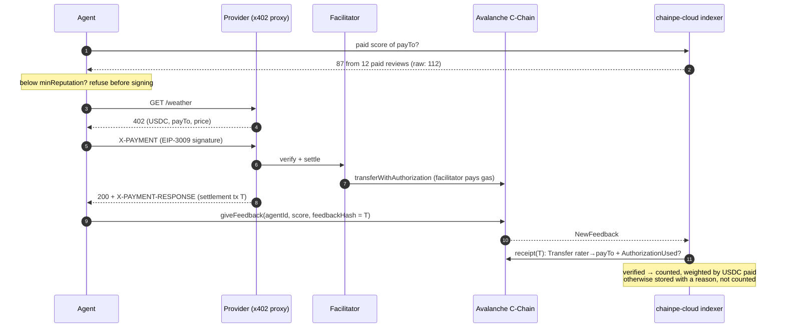
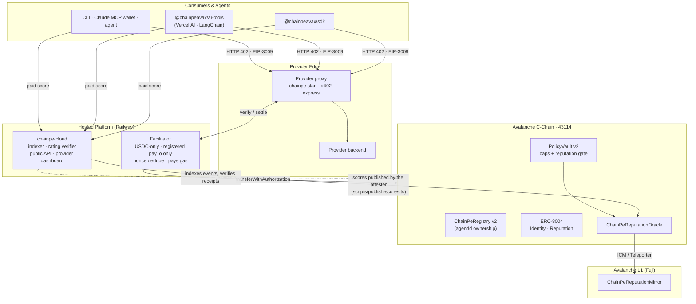

<div align="center">

# ChainPe

### Reputation you can't fake, for the agent economy

**Only agents that actually paid for a service can rate it, and an agent's budget refuses to pay providers with a bad record.**
x402 payments + ERC-8004 reputation + on-chain spending caps in one loop, **live on Avalanche C-Chain mainnet**.

### **[chainpe.vercel.app](https://chainpe.vercel.app/)** · **[Explore live payments](https://chainpe.vercel.app/dashboard/explore)** · **[Docs](https://chainpe.vercel.app/docs)**

[](https://opensource.org/licenses/MIT)
[](https://snowtrace.io/address/0x2a589f1e4e3Cd0A3ee986cec5202aF3760E3170E)
[](https://build.avax.network/events/3f8d455d-1eb5-425b-b859-4261a0ff8ad6)
[](#testing)
[](https://x402.org)
[](https://eips.ethereum.org/EIPS/eip-8004)
<br/>
[](https://www.npmjs.com/package/@chainpeavax/sdk)
[](https://www.npmjs.com/package/@chainpeavax/cli)
[](https://www.npmjs.com/package/@chainpeavax/ai-tools)
[](https://www.npmjs.com/package/@chainpeavax/agent)

</div>

---

## Try it in 60 seconds (for judges)

| | What you'll see | Wallet? |
|---|---|---|
| **[Explore](https://chainpe.vercel.app/dashboard/explore)** | Live x402 USDC settlements on mainnet with Snowtrace links, and every service's **paid score next to its raw score** | No |
| **[Sample provider](https://chainpe.vercel.app/dashboard/sample)** | A provider's dashboard (revenue, calls, reputation), read-only | No |
| **Try it** (on any service card) | 402 → sign EIP-3009 → settlement tx → response → rate it on-chain → ✓ verified paid review | Yes (USDC + a little AVAX) |
| **Run it locally with sample data** | `cd apps/avalanche-dashboard && npm install && VITE_USE_MOCK=true npm run dev`, then open `/explore` | No |

> Explore and the sample provider read live mainnet data. Until the [mainnet rollout](#mainnet-rollout-status) is finished they can show few or no services; the local sample-data mode shows the full experience.

---

## 🏁 Built during the Avalanche Speedrun

ChainPe's payment rails (registry, PolicyVault, ERC-8004 registries, facilitator, SDK, CLI, MCP wallet) were deployed on **2026-06-17**, before the Speedrun. Everything in this table was added **during the Speedrun (November 2026)**:

| | What | Where | Proof | Commits |
|---|---|---|---|---|
| 1 | **Payment-gated reputation.** Every rating carries its x402 settlement tx in `feedbackHash`; the indexer checks that the tx is a USDC `transferWithAuthorization` from the rater to that service's payTo. Only verified ratings count, weighted by USDC paid (capped at 1 USDC each) | `services/chainpe-cloud/src/workers/verifyFeedback.ts`, `src/reputation.ts` | `/v1/public/services` | `7601c58` `2b0f85b` `09d4c40` |
| 2 | **Reputation-gated spending.** SDK, Claude MCP wallet and agent refuse to sign a payment to a provider below `minReputation` (fails closed). PolicyVault v2 enforces the same minimum on-chain through `ChainPeReputationOracle` | `packages/*/src/cloud.ts`, `contracts/contracts/PolicyVaultUpgradeable.sol` | tests (`PolicyVault.reputationGate.test.ts`); mainnet: [rollout](#mainnet-rollout-status) | `a3fb177` `bf8e41d` `94f8adf` `6475a79` |
| 3 | **agentId ownership in the registry.** A service can only link an ERC-8004 agent the caller owns (`NotAgentOwner`), closing reputation hijacking | `contracts/contracts/ChainPeRegistryUpgradeable.sol` | tests (`ChainPeRegistry.agentOwnership.test.ts`); mainnet: [rollout](#mainnet-rollout-status) | `9599a21` |
| 4 | **Portable reputation over ICM.** A verified score is sent from Fuji C-Chain over Teleporter to **our own Avalanche L1** (launched with the Builder Console) and readable there **10.5 s later**. Receivers fail closed | `contracts/contracts/icm/*` | [send tx](https://testnet.snowtrace.io/tx/0xcb7aa4411b8e176d17fb8b8f4767942498563a11223971e6fe8ba536c63fc658) · [L1 delivery](https://build.avax.network/explorer/fuji/2QyrGkChHLjbi76A5uzwF2XEbfN5f3Krovs1j4qPtwe1BUP7h4/tx/0x67f98802f8cc90aae98555bbf40bbb7607165795344d5890420eab5306d0fb2f) | `31ff163` `6c0b9f7` |
| 5 | **Public explorer, in-browser paid call, sample provider.** No wallet needed to see it working | `apps/avalanche-dashboard/src/screens/explore/*` | [Explore](https://chainpe.vercel.app/dashboard/explore) | `3edd37c` `f666509` `2f9a7a3` |
| 6 | **Hardening.** Facilitator only settles real USDC to registered services and never settles one signature twice; CLI proxy no longer exposes its gas key; wallet and agent spending caps fail closed | `services/chainpe-facilitator`, `packages/chainpe`, `packages/chainpe-wallet` | tests | `1298366` `2bcd70d` `94f8adf` |
| 7 | **Honest site.** Fixed an invalid contract address in the docs, removed unbacked claims, deleted two dead apps | `apps/landing` | – | `34c31ef` `fd5a9ba` |

---

## The Problem

AI agents are starting to do real work: calling APIs, hiring other agents, buying data. Two things are missing:

- **Agents can't pay autonomously.** Paid APIs still expect an API key, a signup and a prepaid balance set up by a human.
- **Nobody knows who to trust, and reputation is free to fake.** On-chain reviews cost only gas, so 50 fresh wallets can give any service a perfect score.

## The Solution

| | |
|---|---|
| 💸 **Monetize any HTTP API in one command** | Per-call pricing in USDC, zero backend changes. |
| 🤖 **Agents pay in 3 lines of code** | `cp.fetch` handles HTTP 402 automatically. Agents hold no AVAX. |
| ✅ **Only paying agents can rate** | Each review carries its settlement tx. Fake reviews are shown, but not counted. |
| 🛑 **Bad providers don't get paid** | Agents refuse providers below a payment-verified score, in the SDK and in PolicyVault on-chain. |
| 🔒 **On-chain spending caps** | PolicyVault enforces per-call, daily and total budgets. The chain rejects overspends, not a backend. |
| 🌐 **Reputation follows you across L1s** | Avalanche ICM carries a verified score from C-Chain to any L1. |

ChainPe is infrastructure, not an app. One core powers an SDK, Vercel AI SDK / LangChain tools, a CLI, a Claude MCP wallet, a hosted facilitator, an indexer with a public API, and the explorer.

---

## How payment-gated reputation works



A rating is **verified** only if its tx succeeded, moved USDC from the rater to the payTo of the rated agent's service, carried an EIP-3009 `AuthorizationUsed` signed by the rater next to that transfer, was paid at or before the rating, backs no other rating, was not paid by the provider itself, and was at least 0.001 USDC. Anything else is stored with a reason (`no_proof`, `wrong_payee`, `not_x402`, `reused`, `self_rating`, …) and shown as unverified.

---

## Pay-per-Request in 3 Lines

```ts
import { ChainPe } from '@chainpeavax/sdk'

const cp = new ChainPe({ privateKey: process.env.PRIVATE_KEY, network: 'avalanche', minReputation: 60 })
const res = await cp.fetch('https://api.example.com/paid-endpoint')  // auto-handles 402
const data = await res.json()
```

On `402 Payment Required`, `cp.fetch` checks the provider's payment-verified score, signs a USDC [EIP-3009](https://eips.ethereum.org/EIPS/eip-3009) authorization, sends it to the hosted facilitator and retries, returning the real `200`. The payer signs; the facilitator submits the transaction and pays the gas.

---

## Architecture



`services/chainpe-indexer` is the original discovery indexer. It still runs, but chainpe-cloud's indexer is the source of truth for payments and reputation.

---

## Live Deployment

### Avalanche C-Chain mainnet (chainId 43114)

| Contract | Address | Type |
|---|---|---|
| **ChainPeRegistry** | [`0x2a589f1e4e3Cd0A3ee986cec5202aF3760E3170E`](https://snowtrace.io/address/0x2a589f1e4e3Cd0A3ee986cec5202aF3760E3170E) | UUPS proxy |
| **PolicyVault** | [`0xFe38A9fE7bdA837549fed1b3608d138Bd9a168d8`](https://snowtrace.io/address/0xFe38A9fE7bdA837549fed1b3608d138Bd9a168d8) | UUPS proxy |
| **ERC-8004 IdentityRegistry** | [`0xB1330d7B1b083ba689C7f56bDf667F1F528a3195`](https://snowtrace.io/address/0xB1330d7B1b083ba689C7f56bDf667F1F528a3195) | UUPS proxy |
| **ERC-8004 ReputationRegistry** | [`0xfe7Df66e6BFbd3A76B68dF26b9312E6c85a38543`](https://snowtrace.io/address/0xfe7Df66e6BFbd3A76B68dF26b9312E6c85a38543) | UUPS proxy |
| **ERC-8004 ValidationRegistry** | [`0x91477bD9211448a85eFb16ea858432a85d89b833`](https://snowtrace.io/address/0x91477bD9211448a85eFb16ea858432a85d89b833) | UUPS proxy |
| **USDC (native, Circle)** | [`0xB97EF9Ef8734C71904D8002F8b6Bc66Dd9c48a6E`](https://snowtrace.io/token/0xB97EF9Ef8734C71904D8002F8b6Bc66Dd9c48a6E) | ERC-20 + EIP-3009 |

#### Mainnet rollout status

The Speedrun contract upgrades are written, tested against a mainnet fork and validated for storage-layout safety. The steps that need the owner key are run by hand from [`docs/PHASE3-RUNBOOK.md`](docs/PHASE3-RUNBOOK.md):

| Step | Status |
|---|---|
| ChainPeRegistry v2 (agentId ownership) | pending: `scripts/upgrade-registry.ts` |
| Reserve ERC-8004 agent #0 | pending: `scripts/reserve-agent-zero.ts` |
| Demo services `weather`, `summarize`, `cheap-weather` registered | pending: `examples/proxy-railway/register.sh` |
| chainpe-cloud with the rating verifier and public API | pending: redeploy |
| Seeded paid and unpaid reviews | pending: `e2e/seed-reputation.mjs` |
| Hijack attempt that reverts (`NotAgentOwner`) | pending: `scripts/hijack-attempt.ts` |
| PolicyVault v2 + ChainPeReputationOracle | optional: `scripts/upgrade-policyvault.ts` |

### Fuji testnet: portable reputation over ICM

| | Address / ID |
|---|---|
| ChainPeReputationOracle (Fuji C-Chain) | [`0x2193ED88f7e144D6679405CcBaFB0DDd4d545e84`](https://testnet.snowtrace.io/address/0x2193ED88f7e144D6679405CcBaFB0DDd4d545e84) |
| ChainPeICMSender (Fuji C-Chain) | [`0xD2552df223d370056D6CA6d3a4a4aEDf855197CF`](https://testnet.snowtrace.io/address/0xD2552df223d370056D6CA6d3a4a4aEDf855197CF) |
| ChainPe L1 | chain ID 278944, blockchain ID `2QyrGkChHLjbi76A5uzwF2XEbfN5f3Krovs1j4qPtwe1BUP7h4` |
| ChainPeReputationMirror (L1) | `0x2193ED88f7e144D6679405CcBaFB0DDd4d545e84` |

The L1 was launched with the Builder Console's Quick L1, whose managed validator is removed after 3 days, so the L1-side links stop working after about 2026-11-17. The Fuji C-Chain side stays on Snowtrace. Full run log: [`docs/PHASE5-RUNBOOK.md`](docs/PHASE5-RUNBOOK.md).

### Public API (no sign-in)

| Endpoint | Returns |
|---|---|
| `GET /v1/public/services` | Every active service: price, payTo, agentId, `paidScore`/`paidReviews`, `rawScore`/`rawReviews`, USDC settled, paid calls |
| `GET /v1/public/services/:key/reviews` | Each rating with `verified`, its `verification_reason` and the payment tx |
| `GET /v1/public/feed?limit=50` | Latest verified x402 settlements |
| `GET /v1/public/stats` | Total USDC settled, paid calls, services, verified reviews |
| `GET /v1/public/providers/:address/summary` | Aggregate dashboard data for an allowlisted sample provider |

Base URL: `https://chainpe-cloud-production-1d71cb77.up.railway.app`. Full spec: [`services/chainpe-cloud/openapi.yaml`](services/chainpe-cloud/openapi.yaml).

### Hosted services

| Service | URL |
|---|---|
| Landing + docs | https://chainpe.vercel.app |
| Explorer + provider dashboard (chainpe-cloud) | https://chainpe.vercel.app/dashboard |
| Public API | https://chainpe-cloud-production-1d71cb77.up.railway.app/v1/public/services |
| Facilitator | https://chainpe-facilitator-production-000a.up.railway.app/health |

### Proof of work: mainnet transactions

From the production run on 2026-06-17 (`e2e/mainnet-real-usdc.mjs`, 17/17 checks):

| Step | Tx |
|---|---|
| x402 payment: `transferWithAuthorization`, 0.01 USDC | [`0x953923f2…d92006`](https://snowtrace.io/tx/0x953923f2b653953b4f8b0d5ea1925361a0c967a8cb9b2a542814b7d564d92006) |
| USDC `approve` → registry | [`0x943648bd…8111`](https://snowtrace.io/tx/0x943648bdeafa99c8a02be871d35635f0db774f5188097c3ab128afe1dc328111) |
| `register()` | [`0x1ffb99ec…6493`](https://snowtrace.io/tx/0x1ffb99ecfa2c85f59845ae1f3a3de1d67a8e273458e3bbe733fcfd251aca73f0) |
| `deregister()` | [`0x1bc1e1d2…3d6e`](https://snowtrace.io/tx/0x1bc1e1d29f4514d3c468df2fe6aa0bad98a06bee02d70b47311a36d5b4f5196e) |

---

## 📦 Published npm packages

| Package | What |
|---|---|
| [`@chainpeavax/sdk`](https://www.npmjs.com/package/@chainpeavax/sdk) | Payments, discovery, payment-verified reputation, PolicyVault |
| [`@chainpeavax/ai-tools`](https://www.npmjs.com/package/@chainpeavax/ai-tools) | Vercel AI SDK and LangChain tools |
| [`@chainpeavax/cli`](https://www.npmjs.com/package/@chainpeavax/cli) | Provider CLI: x402 proxy, register, discover |
| [`@chainpeavax/agent`](https://www.npmjs.com/package/@chainpeavax/agent) | Autonomous agent loop with a reputation-aware planner |

The Speedrun versions are sdk 0.3.0, ai-tools 0.3.0, cli 2.1.0 and agent 2.1.0.

---

## Quick Start

### For Providers — Monetize Any API

```bash
npm install -g @chainpeavax/cli
chainpe init      # guided setup → ~/.chainpe/config.json
chainpe start     # x402 payment proxy in front of your API (no backend changes)
chainpe register  # publish on ChainPeRegistry, USDC fee, MetaMask or pasted key
```

The proxy intercepts every request, gates on payment, and forwards to your backend only after the facilitator confirms settlement. Your backend never touches keys, USDC, or x402 headers.

To monetize with `x402-express` directly:

```ts
import { paymentMiddleware } from 'x402-express'
import express from 'express'

const app = express()
app.use(paymentMiddleware(
  process.env.WALLET_ADDRESS,
  { '/*': { price: '$0.01', network: 'avalanche' } },
  { url: 'https://chainpe-facilitator-production-000a.up.railway.app' }
))
app.get('/data', (req, res) => res.json({ result: 'paid content' }))
```

### For Consumers / Agents

<details open>
<summary><b>SDK</b></summary>

```ts
import { ChainPe } from '@chainpeavax/sdk'

const cp = new ChainPe({ privateKey: process.env.KEY, network: 'avalanche' })

// Pay and receive in one call
const res = await cp.fetch('https://api.example.com/endpoint')

// Discover services ranked by payment-verified reputation
const services = await cp.discover({ tags: ['weather', 'ai'] })

// Check USDC + AVAX balances
const { usdc, avax } = await cp.balance()

// Only pay providers with a good payment-verified record
const safe = new ChainPe({ privateKey: process.env.KEY, minReputation: 60 })

// Rate a service after a paid call: attach the settlement tx so it counts as a paid review
await cp.giveFeedback(agentId, 90, { paymentTx })
```
</details>

<details>
<summary><b>Vercel AI SDK</b></summary>

```ts
import { chainpeFetch, discoverService } from '@chainpeavax/ai-tools'

const tools = { chainpeFetch, discoverService }  // drop into generateText / useChat
```
</details>

<details>
<summary><b>LangChain</b></summary>

```ts
import { ChainPeLangChainTools } from '@chainpeavax/ai-tools'

const tools = new ChainPeLangChainTools({ privateKey, network: 'avalanche' }).getTools()
```
</details>

<details>
<summary><b>Claude MCP</b></summary>

```bash
npm run build:mcpb --workspace=chainpe-wallet-mcp
# double-click chainpe.mcpb → installs into Claude Desktop
```

Claude gets 9 tools: `search_bazaar`, `x402_fetch`, `pay`, `transfer_usdc`, `transfer_avax`, `give_feedback`, `spending_report`, `check_balance`, `request_funding`.

Safety settings (Claude Desktop fields or env): `MAX_PER_CALL` (default 0.10 USDC), `MAX_PER_DAY`, `MAX_AVAX_PER_TRANSFER`, `MAX_AVAX_PER_DAY`, and `MIN_REPUTATION` / `MIN_PAID_REVIEWS` to refuse providers without a good payment-verified record. Blank or invalid values fall back to safe defaults, never to "no limit".
</details>

---

## Tech stack

| Layer | What | Avalanche-specific |
|---|---|---|
| Contracts | Solidity 0.8.28, Hardhat, OpenZeppelin UUPS proxies | C-Chain mainnet; ERC-8004 registries; ICM/Teleporter sender, receivers and mirror; our own Fuji L1 |
| Payments | x402 (`x402`, `x402-express`), EIP-3009 `transferWithAuthorization` | Native Circle USDC on C-Chain; hosted Avalanche facilitator that pays AVAX gas |
| Backend | Node.js, Express, Postgres, Drizzle, viem, Railway | Indexes C-Chain within the public RPC's 100-block `eth_getLogs` limit |
| Clients | TypeScript SDK, CLI, Claude MCP wallet, Vercel AI SDK / LangChain tools, agent | `avalanche` / `avalanche-fuji` x402 networks |
| Frontend | Next.js + fumadocs (landing, docs), Vite + React + wagmi (explorer, dashboard) | SIWE and EIP-712 signing on chain 43114, Snowtrace links |
| Cross-chain | `avaplatform/icm-relayer` | Builder Console Quick L1 with Interoperability preinstalled |

---

## Portable reputation via ICM

`ChainPeICMSender` reads a provider's verified score from `ChainPeReputationOracle` and sends it over Avalanche Interchain Messaging (Teleporter, `0x253b2784c75e510dD0fF1da844684a1aC0aa5fcf` on every chain) to `ChainPeReputationMirror` on another L1. An agent there calls `getReputation(payTo)` before hiring, and applies its own minimum to the mirrored `paidReviews`.

- Receivers only accept calls from the Teleporter messenger and only from the trusted sender configured for each source chain. An unconfigured chain is rejected.
- Stale updates (an older source timestamp) are rejected.
- Demonstrated on Fuji: C-Chain → our own L1, delivered by a self-hosted `icm-relayer` in **10.5 s** (links above).

---

## Why Avalanche

Pay-per-request means thousands of tiny USDC payments with an agent waiting on each result. That needs gas small next to a $0.01 call and fast, final settlement.

| Requirement | Avalanche |
|---|---|
| Per-request fees | ~$0.003 per `transferWithAuthorization` (estimate at 1 gwei, [`docs/WHY-AVALANCHE.md`](docs/WHY-AVALANCHE.md)) |
| Finality | ~1–2 s, deterministic |
| USDC | Native Circle USDC (CCTP-enabled) with EIP-3009 |
| Agent identity | ERC-8004 registries on C-Chain |
| Cross-L1 | ICM / Teleporter, no third-party bridge |
| Facilitators | Coinbase's hosted x402 facilitator doesn't support Avalanche mainnet, so a hosted Avalanche facilitator fills a gap |

---

## Security & trust model

- **Upgrade keys.** All mainnet proxies are owned by the deployer EOA `0x3b8a312fac101E7163F9701457d8Dc46cE8fd30a`, which can upgrade them. Moving ownership to a Safe plus `ChainPeTimelock` is prepared (`contracts/scripts/transfer-ownership.ts`) but not done yet. See [`contracts/SECURITY.md`](contracts/SECURITY.md).
- **Facilitator.** Settles only native USDC, only on its configured network, only to payTo addresses of active registered services, above a minimum amount. It checks `authorizationState` and holds a per-nonce lock, so one signature is never settled twice. It never holds funds.
- **Reputation attester.** `ChainPeReputationOracle` trusts one attester (chainpe-cloud) to publish scores. The scores are reproducible from public chain data with the rules above.
- **Clients.** Spending caps in the MCP wallet and agent fail closed on bad config, and spend is recorded at signing. The reputation gate fails closed when chainpe-cloud is unreachable.
- **Known limits.** A provider can still rate itself from fresh wallets it never declared, by paying itself; each payment's weight is capped at 1 USDC. PolicyVault v2 keeps `totalSpent` across `setPolicy`, so `totalBudget` is a lifetime cap. The vault's daily cap resets at the UTC day boundary.

---

## Testing

| Suite | Result |
|---|---|
| Contracts (Hardhat) | 135 passing, 5 pending (live/mainnet-fork, `RUN_LIVE_E2E=1`) |
| chainpe-cloud (indexer, verifier, APIs; real Postgres) | 198 passing |
| chainpe-facilitator | 23 passing |
| chainpe-indexer | 6 passing |
| @chainpeavax/sdk | 41 passing |
| chainpe-wallet (MCP) | 88 passing |
| @chainpeavax/agent | 23 passing |
| @chainpeavax/cli | 5 passing |
| @chainpeavax/ai-tools | 6 passing |
| avalanche-dashboard | money + x402 protocol suites passing (incl. a cross-check against `x402/client`) |
| **Total** | **525 passing** |

```bash
npm install && npm run build && npm test                  # packages
cd contracts && npx hardhat test                          # contracts (live tests: RUN_LIVE_E2E=1)
cd services/chainpe-cloud && TEST_DATABASE_URL=postgres://localhost/chainpe_cloud_test npm test   # needs Postgres
cd services/chainpe-facilitator && npm test
cd apps/avalanche-dashboard && npm test
```

---

## Local development

```bash
git clone https://github.com/SamyaDeb/ChainPe-Avalance.git
cd ChainPe-Avalance
npm install && npm run build

npm run dev:landing                                            # landing + docs on :3002
cd apps/avalanche-dashboard && npm run dev                     # explorer + dashboard (mock mode: see its README)
```

---

## Configuration

| Component | Variables |
|---|---|
| Facilitator | `FACILITATOR_PRIVATE_KEY` (gas key), `NETWORK`, `RPC_URL`, `REGISTRY_ADDRESS`, `MIN_AMOUNT` (default 1000 = 0.001 USDC), `ALLOWED_ORIGINS`, `ALLOW_ANY_PAYTO` (local dev only) |
| chainpe-cloud | `DATABASE_URL`, `SESSION_SECRET`, `AVALANCHE_RPC_URL`, `SIWE_DOMAIN`, `CORS_ORIGIN`, `PUBLIC_CORS_ORIGIN`, `SAMPLE_PROVIDERS`, `GETLOGS_MAX_BLOCKS` (default 100), `REGISTRY_DEPLOY_BLOCK`; build args `VITE_CHAINPE_CLOUD_URL`, `VITE_WALLETCONNECT_PROJECT_ID`, `VITE_SAMPLE_PROVIDER` |
| SDK | constructor options `network`, `minReputation`, `minPaidReviews` (default 3), `cloudUrl`, `maxPerCall`, `autoFeedback` |
| MCP wallet | `CHAINPE_PRIVATE_KEY`, `NETWORK` (default `avalanche`), `MAX_PER_CALL`, `MAX_PER_DAY`, `MAX_AVAX_PER_TRANSFER`, `MAX_AVAX_PER_DAY`, `MIN_REPUTATION`, `MIN_PAID_REVIEWS`, `CHAINPE_CLOUD_URL` |
| Agent | `~/.chainpe/agent.json` (`maxPricePerRequest`, `minReputation`), plus env `MIN_REPUTATION`, `MIN_PAID_REVIEWS`, `CHAINPE_CLOUD_URL` (`off` disables) |
| Landing | `NEXT_PUBLIC_CHAINPE_CLOUD_URL` |
| Dashboard (local) | `VITE_USE_MOCK=true` for sample data |

The contract addresses default to the mainnet deployment everywhere; override them only for your own stack.

---

## Deploy your own stack

```bash
# 1. Contracts (Avalanche mainnet or Fuji)
cd contracts && DEPLOYER_PRIVATE_KEY=0x... npx hardhat run scripts/deploy.ts --network avalanche

# 2. Facilitator (Railway): FACILITATOR_PRIVATE_KEY, NETWORK=avalanche, REGISTRY_ADDRESS
railway up --service chainpe-facilitator

# 3. chainpe-cloud + dashboard: build services/chainpe-cloud/Dockerfile.with-dashboard from the repo root
#    (serves the API and the explorer/dashboard at /dashboard; migrations run at boot)

# 4. Landing: deploy apps/landing to Vercel, proxying /dashboard to chainpe-cloud
```

---

## Roadmap

- x402 v2: CAIP-2 network ids, `PAYMENT-SIGNATURE` header, SIWx sessions
- One shared `@chainpeavax/core` for the payment and reputation clients (today they are repeated in the SDK, wallet and agent)
- Escrow with refunds for undelivered calls; batch settlement; settlement webhooks
- ICTT USDC transfers next to the reputation message, so an L1 agent can fund C-Chain payments
- Retire `services/chainpe-indexer` in favour of chainpe-cloud
- Ownership of all proxies moved to a Safe behind `ChainPeTimelock`

---

## Documentation

| Doc | What it covers |
|---|---|
| [`docs/WHY-AVALANCHE.md`](docs/WHY-AVALANCHE.md) | Measured finality and fees, ICM rationale |
| [`docs/DEPLOYMENTS.md`](docs/DEPLOYMENTS.md) | All addresses and hosted services |
| [`docs/PHASE3-RUNBOOK.md`](docs/PHASE3-RUNBOOK.md) | Mainnet rollout of payment-gated reputation |
| [`docs/PHASE5-RUNBOOK.md`](docs/PHASE5-RUNBOOK.md) | ICM portable reputation on Fuji, with the run log |
| [`docs/SPEEDRUN-PLAN.md`](docs/SPEEDRUN-PLAN.md) | The Speedrun plan, phase by phase |
| [`docs/STRUCTURE.md`](docs/STRUCTURE.md) | Repository layout |
| [`docs/CHANGELOG.md`](docs/CHANGELOG.md) | Version history |
| [`contracts/SECURITY.md`](contracts/SECURITY.md) | Security notes and checklist |

---

## AI tools disclosure

This project was built with AI coding assistance (Claude Code) for code review, implementation, testing and documentation, as allowed by the Speedrun rules. Commits are authored by SamyaDeb, and those made with AI help carry a `Co-Authored-By: Claude` trailer.

---

## License

[MIT](LICENSE)
