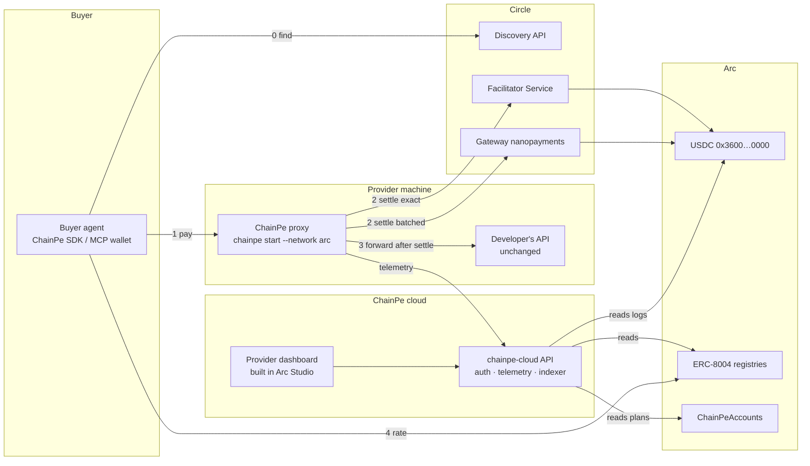
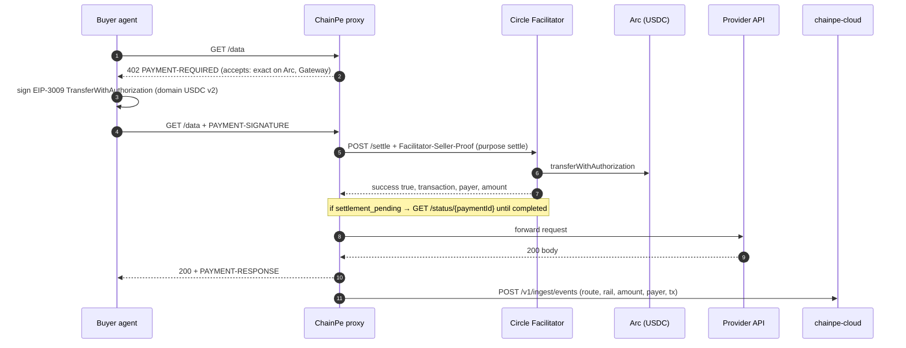
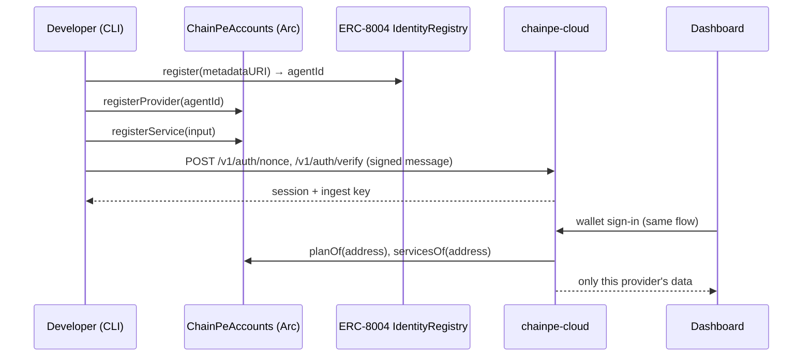

# Architecture — ChainPe on Arc

ChainPe owns the proxy, the client tools, the provider accounts contract, the cloud API and the
dashboard. Circle owns settlement, nanopayments and discovery. Arc holds the money and reputation.

## 1. Components

## 2. Paid call (exact rail)

Gateway rail: same shape, but settle goes through `BatchFacilitatorClient` and funds land in the
seller's Gateway balance; `chainpe withdraw` moves them on-chain.

## 3. Registration + dashboard access

## 4. Arc constants

Sources: [Arc contract addresses](https://docs.arc.io/arc/references/contract-addresses),
[Connect to Arc](https://docs.arc.io/arc/references/connect-to-arc).

| Item | Mainnet | Testnet |
|---|---|---|
| Chain ID | 5042 | 5042002 |
| CAIP-2 (x402 v2) | `eip155:5042` | `eip155:5042002` |
| RPC | `https://rpc.mainnet.arc.io` | `https://rpc.testnet.arc.io` |
| Explorer | `https://explorer.arc.io` | `https://explorer.testnet.arc.io` |
| Faucet | — | `https://faucet.circle.com` |
| USDC (ERC-20, 6 dec; EIP-712 name `USDC`, version `2`) | `0x3600000000000000000000000000000000000000` | same |
| ERC-8004 IdentityRegistry | `0x8004A169FB4a3325136EB29fA0ceB6D2e539a432` | `0x8004A818BFB912233c491871b3d84c89A494BD9e` |
| ERC-8004 ReputationRegistry | `0x8004BAa17C55a88189AE136b182e5fdA19dE9b63` | `0x8004B663056A597Dffe9eCcC1965A193B7388713` |
| ERC-8004 ValidationRegistry | `0x8004Cc8439f36fd5F9F049D9fF86523Df6dAAB58` | `0x8004Cb1BF31DAf7788923b405b754f57acEB4272` |
| GatewayWallet | `0x77777777Dcc4d5A8B6E418Fd04D8997ef11000eE` | `0x0077777d7EBA4688BDeF3E311b846F25870A19B9` |
| GatewayMinter | `0x2222222d7164433c4C09B0b0D809a9b52C04C205` | `0x0022222ABE238Cc2C7Bb1f21003F0a260052475B` |
| Permit2 | `0x000000000022D473030F116dDEE9F6B43aC78BA3` | same |
| ChainPeAccounts | not deployed | `0xD315322c9D83A6f50A04236A2a242e0259bfB580` |

EVM differences that bite (from Arc docs): gas is paid in USDC; mempool floor `maxFeePerGas` 20 gwei;
sends to `address(0)` revert; blocklisted addresses revert; finality < 1 s (no confirmation waits);
all USDC `Transfer` logs are also emitted by system address `0xffffFFFfFFffffffffffffffFfFFFfffFFFfFFfE`.

## 5. Circle endpoints

| Service | URL | Notes |
|---|---|---|
| Facilitator Service | `https://api.circle.com/v1/facilitator/x402` | `POST /settle`, `POST /verify` (upto), `GET /status/{paymentId}`, `GET /supported`; header `Facilitator-Seller-Proof`; production needs `Authorization: Bearer <CIRCLE_API_KEY>` |
| Gateway (batched) testnet | `https://gateway-api-testnet.circle.com` | used by `@circle-fin/x402-batching` |
| Gateway mainnet | `https://gateway-api.circle.com` | default in `@circle-fin/x402-batching` 4.0.0 |
| Discovery API | `https://api.circle.com/v2/x402/discovery/resources` | keyless; params `query`, `category`, `network`, `maxUsdPrice`, `supportsCircleGateway` |
| Get listed | intake form (developers.circle.com/agent-stack/agent-marketplace/get-listed) | manual review |

## 6. Packages

| Package | Version | Used by |
|---|---|---|
| `@x402/core`, `@x402/evm`, `@x402/express`, `@x402/fetch` | 2.30.x | CLI, SDK, wallet |
| `@circle-fin/x402-batching` | 4.0.x | CLI: `CircleFacilitatorClient`, `BatchFacilitatorClient`, `GatewayEvmScheme`; SDK/wallet: `GatewayClient`, `CompositeEvmScheme` |
| `viem` | ^2.21 | all |
| `@circle-fin/arc-studio-cli` | 1.2.x | developer machine (global) |

## 7. Environment variables

| Var | Where | Meaning |
|---|---|---|
| `CHAINPE_NETWORK` | all | `arc` \| `arc-testnet` (CLI). Packages not yet ported still accept `avalanche` \| `fuji` |
| `ARC_RPC_URL`, `ARC_TESTNET_RPC_URL` | all | RPC overrides |
| `CHAINPE_SELLER_PRIVATE_KEY` | CLI | payout key; signs seller proofs and Gateway withdrawals |
| `CIRCLE_API_KEY` | CLI | Facilitator production key (optional on testnet trial) |
| `CIRCLE_FACILITATOR_URL` | CLI | default `https://api.circle.com/v1/facilitator/x402` |
| `CIRCLE_GATEWAY_URL` | CLI | default testnet URL above |
| `CHAINPE_ACCOUNTS_ADDRESS` | CLI, cloud | deployed `ChainPeAccounts` |
| `CHAINPE_CLOUD_URL` | CLI, dashboard | `chainpe-cloud` base URL |
| `CHAINPE_INGEST_KEY` | CLI | issued by `chainpe login` |
| `CHAINPE_PRIVATE_KEY` | SDK, MCP wallet | buyer key |
| `DATABASE_URL` | cloud | Postgres |
| `SESSION_SECRET` | cloud | signs dashboard sessions |
